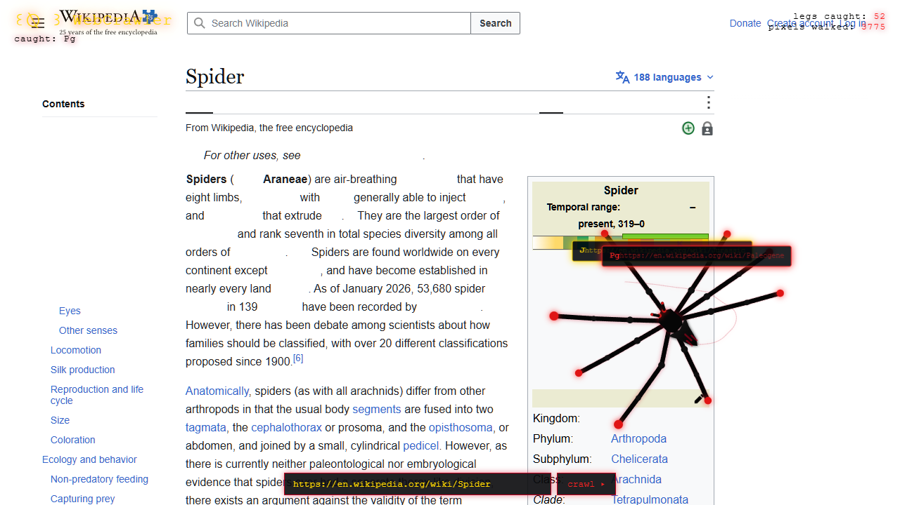

# WebCrawler

WebCrawler turns a live webpage into a small interactive scene. It serves a target page through a local proxy, draws a wandering spider over it, and reveals floating labels when the spider touches links, images, or short numeric values.



## Requirements

- Python 3.8 or newer
- Internet access to load the page you want to explore

The project uses only the Python standard library. Installing [`certifi`](https://pypi.org/project/certifi/) is optional and can help on Windows systems with incomplete certificate stores:

```powershell
pip install -r requirements.txt
```

## Run (Local)

Start the crawler with its default target, the Wikipedia Spider article:

```powershell
python crawler.py
```

Then open [http://localhost:8000](http://localhost:8000).

Options:

```powershell
python crawler.py https://example.com --port 8080 --timeout 20 --user-agent "CustomAgent/1.0"
python crawler.py https://example.com --no-consume
```

Open `http://localhost:8080` when using a custom port. Stop the server with `Ctrl+C`.

## Deploy (Vercel)

This project is Vercel-ready. Deploy the repo; the `/proxy` endpoint is served via `api/proxy.py`. When deployed, use the URL bar to crawl any http/https page - the proxy strips scripts and frame-blocking headers for compatibility.

## Use

- Enter a URL in the bar at the bottom of the page and choose **crawl**, or press `Enter`.
- The spider roams automatically and keeps a running count of caught items and distance travelled.
- A first contact with a link, image, or focused numeric value produces a floating label. Repeated contacts with the same item are rate-limited.
- Caught links are visually consumed; caught images are hidden while their layout remains in place (toggle "consume" to disable).
- Use the **collected** panel to review caught items, **history** dropdown for recent URLs, **clear** to reset memory, and **export** to save a canvas snapshot.

## How It Works

`crawler.py` starts a threaded local web server. Its `/proxy` endpoint fetches the requested HTML, removes scripts and event handlers, rewrites relative `href` and `src` (including `srcset`) attributes to absolute URLs, strips frame-blocking headers/meta, and serves the cleaned page to the browser.

`index.html` renders that proxied page in a full-screen iframe and places a canvas-based, eight-legged spider above it. The overlay inspects visible page elements and responds to leg contacts.

## Project Files

| File | Purpose |
| --- | --- |
| `crawler.py` | Local HTTP server and remote-page proxy/cleaner with CLI options. |
| `api/proxy.py` | Vercel serverless proxy with frame-header stripping. |
| `index.html` | Interactive WebCrawler interface, spider animation, UI controls. |
| `vercel.json` | Vercel deployment configuration. |
| `qa.mjs` | Browser-test helper that waits for the animation, records UI state, and writes `shot.png`. |
| `requirements.txt` | Optional dependencies (certifi). |
| `shot.png` | Example browser capture. |

## Notes

- Only `http://` and `https://` URLs are accepted by the proxy.
- Some websites may not render fully because they require JavaScript, block automated requests, or depend on browser security policies. The proxy deliberately removes page scripts before rendering.
- This is a local exploratory tool, not a full web scraper. Be mindful of the sites you visit and their terms of use.
